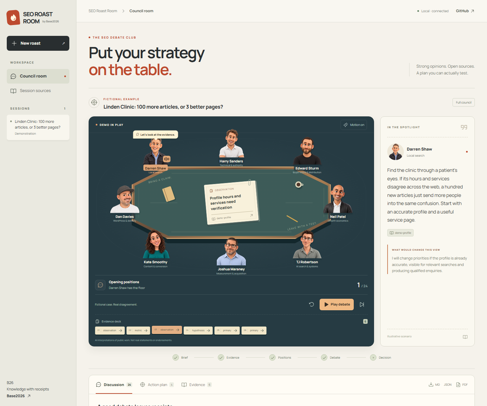

# SEO Roast Room

**Put your strategy on the table. Eight perspectives. One testable next move.**

Bring a website, a strategy, or a difficult search-growth decision. Eight distinct expert simulations challenge the assumptions, inspect the evidence, and leave you with a testable plan. An original tabletop arena makes the debate visible: animated cartoon speakers, source cards dealt onto an octagonal table, challenges, expert dossiers and an action board.

**English interface. Any-language conversations.** Write your brief in your language, or choose a response language. Your questions, discussion and findings keep that language; interface labels and public project materials are English.

Inspired by [Roast Room](https://github.com/nateherkai/roast-room). Independently implemented for SEO and Codex, with research grounded in [Base2026](https://base2026.dev). Claude adaptation is intentionally deferred.



## Try it

Requires **Node.js 22+** and a Codex client with skills support. The room ships prebuilt and has no runtime npm dependencies or model API key requirement.

```sh
git clone https://github.com/offflinerpsy/seo-roast-room.git
cd seo-roast-room
npm start
```

Open **http://127.0.0.1:4740**. The clearly labeled fictional demo lets you inspect the full council immediately. `Ctrl+C` stops the room.

### Install in Codex

The repository includes a portable `plugin.json`, a Codex compatibility manifest, the `seo-roast` skill and a repo marketplace. The compatibility manifest exposes explicit version/skill metadata to Codex CLI 0.145.0; both layouts share exactly the same implementation. Install with:

```sh
codex plugin marketplace add offflinerpsy/seo-roast-room
codex plugin add seo-roast-room@base2026-seo
```

Start a fresh Codex chat after installation. In clients that expose local marketplaces in the Plugins Directory, choose **Base2026 SEO** and install **SEO Roast Room**. Client capabilities vary; this is a repository-distributed plugin, not a claim of inclusion in OpenAI's public directory. See the [official plugin guide](https://developers.openai.com/plugins/build/plugins).

You can also copy the **entire** `skills/seo-roast` directory into your workspace's `.agents/skills/seo-roast/`. Keep its scripts, brains, room and assets together. Do not copy only `SKILL.md`. This skill-only route uses the built-in research CLI instead of requiring a configured MCP connection.

### Run a real council

In Codex:

```text
Use $seo-roast-room:seo-roast in quick mode to review https://example.com.
We sell [offer] to [audience] in [market].
Our objective is [qualified enquiries / sales / another outcome].
Constraints: [time, team, budget]. Available evidence: [files/tools].
Start the room so I can follow the debate.
```

Or create a brief in the room and paste its generated instruction into Codex. The instruction includes the exact session directory, including a custom `--sessions` path. The room waits for Codex to research and publish the rounds. It never fakes a live model response or runs a shell from a web request.

The optional **Response language** field accepts a language name or tag, such as `Spanish`, `Arabic` or `pt-BR`. Leave it blank to match your request. Existing sessions are preserved. To update an installed plugin, run `codex plugin marketplace upgrade base2026-seo`, then `codex plugin add seo-roast-room@base2026-seo` and start a fresh chat.

Codex namespaces the plugin skill as `seo-roast-room:seo-roast`. For the standalone copied skill, use `$seo-roast` instead.

## The council

| Seat | Responsibility | Product's editorial character |
| --- | --- | --- |
| Darren Shaw | Local search and business information | The patient map detective |
| Harry Sanders | Technical foundations and information gain | The sharp foundation builder |
| Edward Sturm | Buyer intent and distribution | The inventive demand hunter |
| Neil Patel | Growth economics | The commercial systems thinker |
| TJ Robertson | AI search and repeatable systems | The skeptical systems architect |
| Joshua Maraney | Measurement and paid/organic acquisition | The accountable agency operator |
| Kate Smoothy | Commercial content and conversion | The candid commercial editor |
| Dan Davies | WordPress, implementation and recovery | The practical workshop engineer |

Each dossier distinguishes attributed public ideas, our practical interpretation, authored character, uncertain claims, disagreements and conditions that change the seat's mind. Initial research retrieved 20 public records per selected creator and curated 42 sources into the dossiers. This is a bounded initial knowledge base, not an exhaustive reconstruction of anyone's work. [Research method and coverage](docs/RESEARCH.md).

These are **independent fictional AI simulations**, not the people, their statements or endorsements. No real quotes are invented. Illustrated likenesses are disclosed as generated. See [attribution and corrections](docs/ATTRIBUTION.md).

## What is different

- **Evidence before performance.** Observations, metrics, primary guidance, practitioner claims and hypotheses have different labels.
- **Useful disagreement.** Opening positions, challenges and a decision. The strongest dissent survives the vote.
- **No fake score.** Unknown data stays unknown; no mathematically dressed-up SEO grade or promised ranking lift.
- **Implementable actions.** Owner role, effort, confidence, evidence and an acceptance check. Experiments also carry a baseline, measurement, success/stop criteria and a window.
- **Private by default.** Local session files, no telemetry, no model API in the viewer. Public Base2026 lookup sends only selected research terms and handles.
- **Playable, inspectable debate.** Follow the active speaker, open the actual cited card, step through turns, or replay the clearly labeled demo. Challenges appear when a published challenge reaches the table. Pause and reduced-motion controls keep it comfortable. No synthetic voices or fabricated activity.
- **Portable and multilingual.** Codex skill, Node CLI, live SSE room, JSON/Markdown export and complete browser print-to-PDF. English presentation; conversation text stays in the requested language.

## Modes and cost

`quick` selects up to three seats for opening and challenge; `council` uses up to eight and adds final positions; `consult` uses one seat. Codex performs the reasoning within your account's normal limits. Independent subagents are used only when available and allowed; otherwise the skill discloses a sequential simulation. No promise of zero token usage or subscription availability.

The optional public Base2026 MCP is declared in `mcp.json`. Without it:

```sh
npm run roast -- research --query "internal linking" --creator harrysandersseo --limit 5
```

The research command is read-only and prints attributed results. It does not automatically promote a source claim into a verified finding.

## Session protocol

Sessions default to `.seo-roast/sessions` in the caller's workspace and are ignored by Git. The CLI validates versioned JSON, evidence references and round completeness. Writes are atomic and use an expected revision to prevent silent lost updates. Finished sessions are immutable; create a follow-up to revisit them.

```sh
npm run roast -- create --file brief.json
npm run roast -- validate --file draft.json
npm run roast -- publish --file draft.json --expected-revision 0
npm run roast -- report --file .seo-roast/sessions/SESSION-ID.json
```

[Session format](skills/seo-roast/references/session-format.md) · [Architecture](docs/ARCHITECTURE.md) · [Security](SECURITY.md)

## Development

```sh
npm ci
npm run build
npm test
npm run check
npx playwright install chromium
npm run test:ui
```

React/TypeScript, Tailwind and Vite are build-time dependencies. `npm run build` writes the prebuilt room into the packaged skill; commit updated build artifacts when changing the UI. To use Vite during development, start the room on port 4740 and run `npm run dev` in another terminal.

Add an expert through [CONTRIBUTING.md](CONTRIBUTING.md), with source-backed knowledge, an original avatar and passing checks. Do not add an unresearched celebrity skin.

## Project and license

[GitHub issues](https://github.com/offflinerpsy/seo-roast-room/issues) are the public bug/feature tracker. [Linear](https://linear.app/agregator/project/seo-roast-room-afb385165add) is the maintainer's delivery board; access may require workspace membership. Links are maintained explicitly; there is no automatic bidirectional sync.

MIT for project code, original text and generated artwork to the extent licensable. Third-party materials retain their rights. [Third-party notices](THIRD_PARTY_NOTICES.md). No affiliation with the featured creators, search engines, OpenAI or the original Roast Room author.
